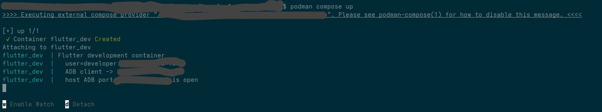
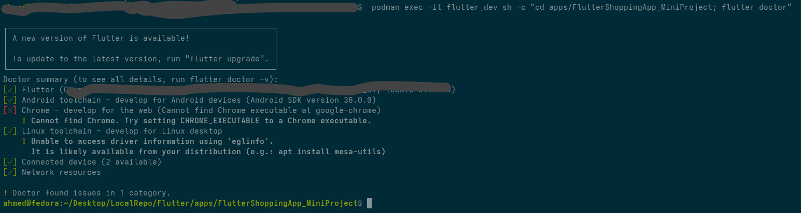
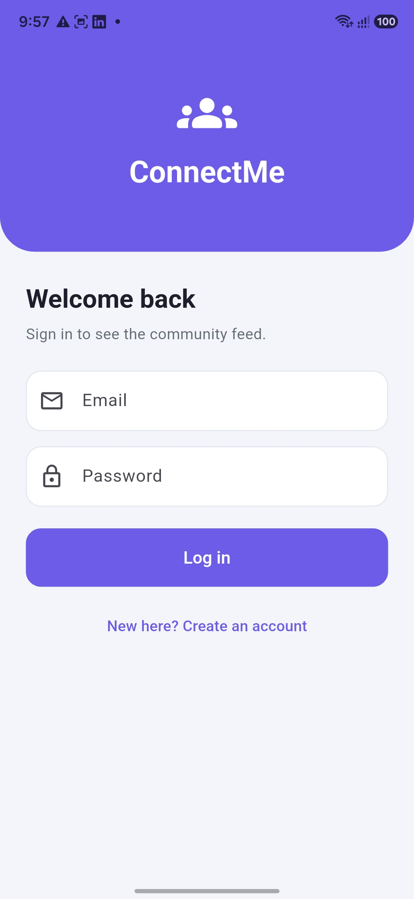
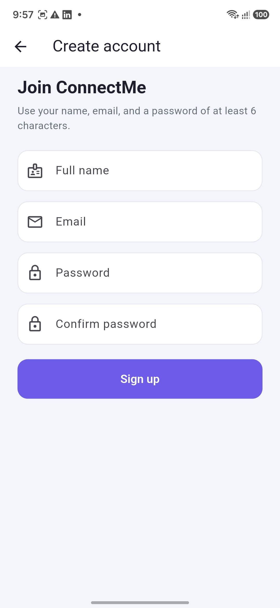
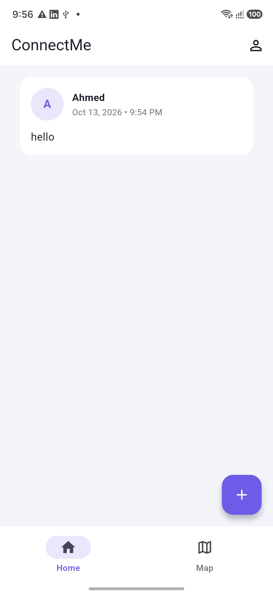
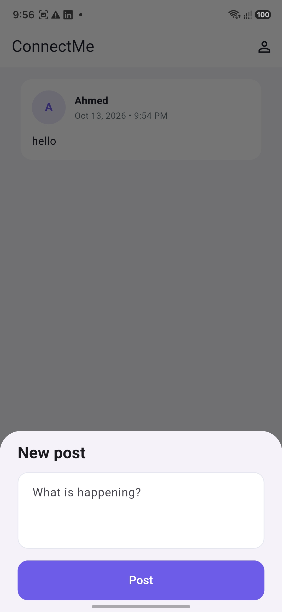
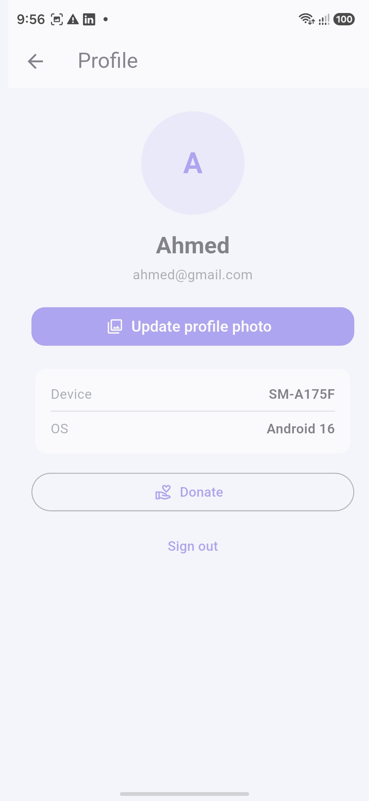
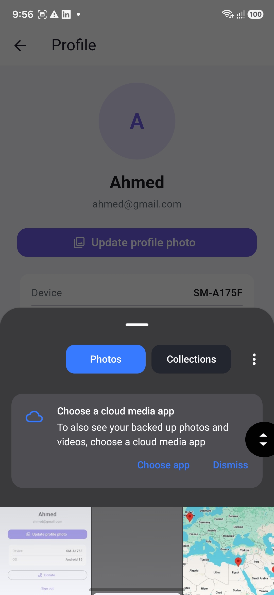
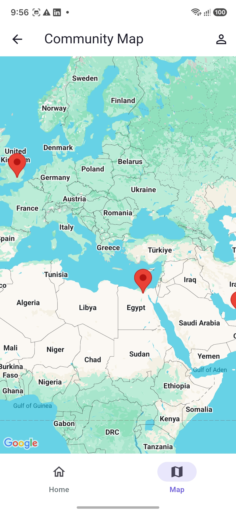

# ConnectMe Community App

Flutter community app with Firebase email login, a live Firestore feed, a fingerprint gate before the profile, a Google Map of members, and a small donation flow. State is handled with Cubits. The project is split into data, domain, and presentation layers.

---

## Requirements

- [Flutter SDK](https://docs.flutter.dev/get-started/install) (Dart `^3.12.2`)
- Android SDK, with an emulator or device that has Google Play
- Git
- A Firebase project with Email/Password, Cloud Firestore, Storage, and App Distribution
- A Google Maps SDK for Android key in `android/app/src/main/AndroidManifest.xml`

Check your setup:

```bash
flutter doctor
```

or

```bash
podman exec -it flutter_dev sh -c "cd apps/FlutterCommunityApp_MiniProject_AI; flutter doctor"
```




---

## Clone the project

```bash
git clone https://github.com/AhmedSobhyHamed/FlutterCommunityApp_MiniProject_AI.git
cd FlutterCommunityApp_MiniProject_AI
```

`android/app/google-services.json` must stay in the Android app. Its package name is `com.example.fluttercommunityapp_miniproject_ai`.

---

## Install packages

From the project root:

```bash
flutter pub get
```

```bash
flutter pub add flutter_bloc:^9.1.1
flutter pub add get_it:^9.3.0
flutter pub add equatable:^3.0.0
flutter pub add intl:^0.18.1
flutter pub add firebase_core:^4.15.0
flutter pub add firebase_auth:^6.7.0
flutter pub add cloud_firestore:^6.10.0
flutter pub add firebase_storage:^13.6.0
flutter pub add image_picker:^1.2.4
flutter pub add google_maps_flutter:^2.18.1
flutter pub add local_auth:^3.0.2
flutter pub add device_info_plus:^12.4.0
```

or

```bash
podman exec -it flutter_dev sh -c "cd apps/FlutterCommunityApp_MiniProject_AI; flutter pub get"
podman exec -it flutter_dev sh -c "cd apps/FlutterCommunityApp_MiniProject_AI; flutter pub add flutter_bloc:^9.1.1"
podman exec -it flutter_dev sh -c "cd apps/FlutterCommunityApp_MiniProject_AI; flutter pub add get_it:^9.3.0"
podman exec -it flutter_dev sh -c "cd apps/FlutterCommunityApp_MiniProject_AI; flutter pub add equatable:^3.0.0"
podman exec -it flutter_dev sh -c "cd apps/FlutterCommunityApp_MiniProject_AI; flutter pub add intl:^0.18.1"
podman exec -it flutter_dev sh -c "cd apps/FlutterCommunityApp_MiniProject_AI; flutter pub add firebase_core:^4.15.0"
podman exec -it flutter_dev sh -c "cd apps/FlutterCommunityApp_MiniProject_AI; flutter pub add firebase_auth:^6.7.0"
podman exec -it flutter_dev sh -c "cd apps/FlutterCommunityApp_MiniProject_AI; flutter pub add cloud_firestore:^6.10.0"
podman exec -it flutter_dev sh -c "cd apps/FlutterCommunityApp_MiniProject_AI; flutter pub add firebase_storage:^13.6.0"
podman exec -it flutter_dev sh -c "cd apps/FlutterCommunityApp_MiniProject_AI; flutter pub add image_picker:^1.2.4"
podman exec -it flutter_dev sh -c "cd apps/FlutterCommunityApp_MiniProject_AI; flutter pub add google_maps_flutter:^2.18.1"
podman exec -it flutter_dev sh -c "cd apps/FlutterCommunityApp_MiniProject_AI; flutter pub add local_auth:^3.0.2"
podman exec -it flutter_dev sh -c "cd apps/FlutterCommunityApp_MiniProject_AI; flutter pub add device_info_plus:^12.4.0"
```

This installs:

| Package | Role |
|---|---|
| `flutter_bloc` | `AuthCubit`, `PostCubit`, `ProfileCubit` |
| `get_it` | Dependency injection in `lib/injection.dart` |
| `equatable` | Value equality for states and entities |
| `intl` | Post timestamps |
| `firebase_core` | Firebase startup on Android |
| `firebase_auth` | Email and password login and sign up |
| `cloud_firestore` | Posts, user profiles, donations |
| `firebase_storage` | Profile photo file. The user document stores the download URL |
| `image_picker` | Gallery photo |
| `google_maps_flutter` | Community Map |
| `local_auth` | Fingerprint gate before Profile |
| `device_info_plus` | Device model and OS version |
| `cupertino_icons` | Icons |

---

## Run the project

```bash
flutter devices
flutter run
```

or

```bash
podman exec -it flutter_dev sh -c "cd apps/FlutterCommunityApp_MiniProject_AI; flutter devices"
podman exec -it flutter_dev sh -c "cd apps/FlutterCommunityApp_MiniProject_AI; flutter run"
```

Pick an Android device if more than one is connected:

```bash
flutter run -d emulator-5554
```

or

```bash
podman exec -it flutter_dev sh -c "cd apps/FlutterCommunityApp_MiniProject_AI; flutter run -d emulator-5554"
```

Maps and the fingerprint prompt need Android. Chrome cannot show them.

Before the first login, turn these on in the Firebase console:

- Authentication → Email/Password
- Cloud Firestore
- Storage

Use rules that allow a signed-in user to read and write. Test mode is enough for the beta:

```
rules_version = '2';
service cloud.firestore {
  match /databases/{database}/documents {
    match /{document=**} {
      allow read, write: if request.auth != null;
    }
  }
}
```

Storage:

```
rules_version = '2';
service firebase.storage {
  match /b/{bucket}/o {
    match /{allPaths=**} {
      allow read, write: if request.auth != null;
    }
  }
}
```

---

## Tech stack

| Layer | Technology |
|---|---|
| UI | Flutter, Material 3 |
| Language | Dart 3.12+ |
| Navigation | Login and sign up, home feed, Community Map, profile |
| State | `flutter_bloc` — `AuthCubit`, `PostCubit`, `ProfileCubit` |
| DI | GetIt in `lib/injection.dart` |
| Backend | Firebase Auth, Cloud Firestore, Firebase Storage |
| Device | `local_auth`, `image_picker`, `device_info_plus` |
| Map | `google_maps_flutter` |
| Patterns | Singleton (`FirestoreService`), Factory (post data source), Builder (`UserBuilder`) |

---

## Permissions

| Permission | Why |
|---|---|
| `INTERNET` | Firebase Auth, Firestore, Storage, and map tiles |
| `USE_BIOMETRIC` | Fingerprint prompt before the profile screen |
| `USE_FINGERPRINT` | Older Android fingerprint API used by `local_auth` |

The gallery uses the system photo picker, so the app does not request broad photo storage access. The map uses three fixed cities, so it does not request location.

`MainActivity` extends `FlutterFragmentActivity` because `local_auth` needs it.

---

## Project structure

```
lib/
├── main.dart
├── injection.dart                         # GetIt registrations
├── core/
│   ├── errors/failures.dart
│   ├── themes/
│   │   ├── app_colors.dart
│   │   └── app_theme.dart
│   └── utils/
│       ├── error_message.dart
│       ├── responsive.dart
│       ├── result.dart
│       └── validators.dart
├── data/
│   ├── datasources/
│   │   ├── firestore_post_datasource.dart
│   │   ├── local_post_datasource.dart
│   │   ├── post_datasource.dart
│   │   └── post_datasource_factory.dart   # Factory
│   ├── models/
│   │   ├── donation_model.dart
│   │   ├── post_model.dart
│   │   └── user_model.dart                # UserBuilder
│   └── repositories/
│       ├── auth_repository_impl.dart
│       ├── firestore_donation_processor.dart
│       ├── post_repository_impl.dart
│       └── profile_repository_impl.dart
├── domain/
│   ├── entities/
│   ├── repositories/
│   └── usecases/
├── presentation/
│   ├── blocs/
│   │   ├── auth_cubit.dart
│   │   ├── post_cubit.dart
│   │   └── profile_cubit.dart
│   ├── screens/
│   │   ├── auth_gate.dart
│   │   ├── login_screen.dart
│   │   ├── sign_up_screen.dart
│   │   ├── home_screen.dart
│   │   ├── profile_screen.dart
│   │   ├── map_screen.dart
│   │   └── splash_screen.dart
│   └── widgets/
│       ├── post_card.dart
│       ├── member_marker.dart
│       └── ...
└── services/
    ├── firestore_service.dart             # Singleton
    ├── auth_service.dart
    ├── biometric_service.dart
    ├── device_info_service.dart
    └── storage_service.dart
```

### How the layers fit

- **Presentation** — screens and widgets. Cubits expose loading, loaded, and error states. They call use cases only.
- **Domain** — `AppUser`, `Post`, repository contracts, and one use case per action.
- **Data** — Firestore and Storage implementations, `fromJson` / `toJson` models, and the post data-source factory.
- **Auth** — `AuthCubit` listens to Firebase auth. A signed-in user skips login on the next launch. Failures show a short message on the form.
- **Feed** — `PostCubit` watches the `posts` collection. The repository asks the factory for the remote source and keeps a local cache if the network call fails.
- **Profile** — the app bar person icon runs fingerprint authentication, then opens the profile. The photo file goes to Storage and the download URL is saved on the Firestore user document so the avatar updates immediately.
- **Map** — full-screen Google Map titled Community Map. Markers for Cairo, Dubai, and London open an info window with the member name and city.
- **Donation** — `SendDonation` depends on the `DonationProcessor` interface. `FirestoreDonationProcessor` is the current writer. Another processor can replace it without changing the use case.

### Design patterns

- **Singleton** — `FirestoreService` keeps one Firestore entry point for the app lifecycle.
- **Factory** — `PostDataSourceFactory` builds either the Firestore source or the in-memory cache.
- **Builder** — `UserBuilder` sets only the fields collected at sign-up. The photo stays unset until the gallery step.
- **SOLID donation** — the use case depends on `DonationProcessor` (dependency inversion). The Firestore writer has one job (single responsibility). A new writer can be added without editing the use case (open/closed).

---

## Useful commands

```bash
flutter pub get
flutter run
flutter test
flutter analyze
dart format .
```

or

```bash
podman exec -it flutter_dev sh -c "cd apps/FlutterCommunityApp_MiniProject_AI; flutter pub get"
podman exec -it flutter_dev sh -c "cd apps/FlutterCommunityApp_MiniProject_AI; flutter run"
podman exec -it flutter_dev sh -c "cd apps/FlutterCommunityApp_MiniProject_AI; flutter test"
podman exec -it flutter_dev sh -c "cd apps/FlutterCommunityApp_MiniProject_AI; flutter analyze"
podman exec -it flutter_dev sh -c "cd apps/FlutterCommunityApp_MiniProject_AI; dart format ."
```

---

## Beta distribution

Build the release APK, then upload it with the Firebase CLI. Replace `YOUR_FIREBASE_ANDROID_APP_ID` with the Android app id from Firebase Project settings → Your apps. Replace the tester emails with two real Gmail addresses.

```bash
flutter build apk --release
```

or

```bash
podman exec -it flutter_dev sh -c "cd apps/FlutterCommunityApp_MiniProject_AI; flutter build apk --release"
```

```bash
firebase login
firebase appdistribution:distribute build/app/outputs/flutter-apk/app-release.apk \
  --app YOUR_FIREBASE_ANDROID_APP_ID \
  --testers "tester1@gmail.com,tester2@gmail.com" \
  --release-notes "ConnectMe beta 1.0.0"
```

Each tester gets an email from Firebase App Distribution with a link to install the build.

---

## Screenshots

### Login



### Sign up



### Home feed



### New post



### Profile



### Profile photo



### Community Map


